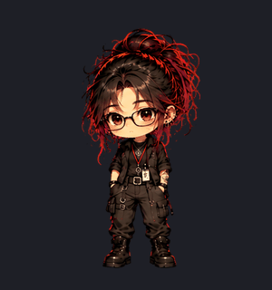
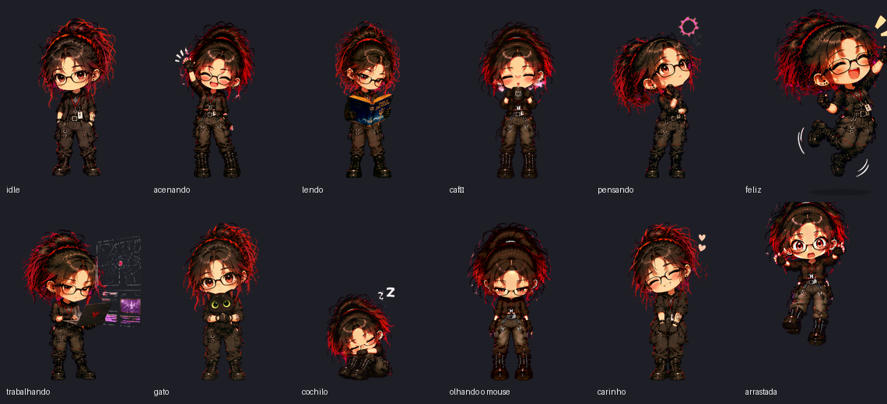
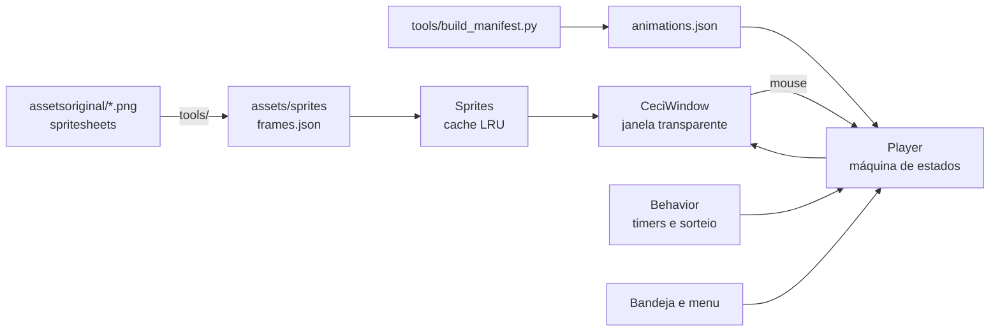

<p align="center">
  
</p>

<h1 align="center">Ceci Bot</h1>

<p align="center">
  Uma mascote chibi animada que mora na área de trabalho do Windows.<br>
  <b>100% offline</b> · <b>sem IA</b> · <b>leve</b> (≈0,5% de CPU e ~60 MB de RAM, medidos)
</p>

<p align="center">
  
  
  
  
</p>

<p align="center">
  
</p>

---

## ✨ O que ela faz

- **Vive na tela**: janela transparente e sem borda. Os cliques passam pelas áreas vazias, e ela fica sempre por cima das outras janelas (opcional).
- **Fala com você**: um balão em cima da cabeça escreve letra a letra, como nos RPGs antigos. São 242 frases fixas em 29 situações: cliques, carinho, arraste, café, leitura, sono, o gato e outras. As falas saem em sequência, nunca uma cortando a outra. Não usa IA.
- **Tem rotina própria**: respira, pisca, ajeita os óculos, lê, toma café, brinca com o gato, cochila e passeia pela tela. Tudo isso por timers e sorteio, sem IA.
- **Reage a você**:
  - **Mouse**: os olhos seguem o cursor quando você mexe rápido.
  - **Carinho**: ela reage quando você clica na cabeça ou passa o mouse por cima.
  - **Clique no corpo**: ela acena ou fica curiosa.
- **Pode ser arrastada**: ela fica pendurada enquanto você segura. Solta no ar, ela cai, sente o impacto e se levanta. Levada até a borda de baixo, pousa na hora.
- **Transições suaves**: dissolve entre os quadros e entre as animações, sem teleportes. As atividades repetem só o "miolo" (ex.: folhear o livro) e só guardam as coisas quando ela vai fazer outra coisa.
- **Sai com estilo**: ao fechar, ela anda até o canto mais próximo e sai correndo pela borda da tela. Depois volta só a mão para buscar o livro que caiu.
- **Respeita o seu PC**: pausa em jogos e apps em tela cheia. Ao ser ocultada, todos os timers param. Tem modo econômico.

## 🖼️ Galeria

<p align="center">
  
</p>

São **56 animações** feitas a partir de 57 spritesheets desenhadas à mão. A lista completa está no painel **Ver animações** do próprio app.

## 📦 Instalar

### Opção 1: executável (recomendado)

1. Baixe o `CeciBot-windows.zip` na página de [Releases](../../releases/latest).
2. Extraia a pasta onde quiser.
3. Abra o `Ceci Bot.exe`.

As configurações ficam em `%APPDATA%\Ceci Bot\settings.json`. O .exe e a versão de código usam o mesmo arquivo.

### Opção 2: rodar pelo código

```bash
pip install -r requirements.txt
python main.py
```

Use `pythonw main.py` para abrir sem console. O app só precisa do `PySide6-Essentials`.

### Gerar o executável

```powershell
powershell -ExecutionPolicy Bypass -File tools\build_exe.ps1
```

O script gera `%LOCALAPPDATA%\Programs\Ceci Bot\Ceci Bot.exe` com PyInstaller e cria o atalho na área de trabalho.

## 🖱️ Como interagir

| Ação | O que acontece |
|---|---|
| Mexer o mouse rápido perto dela | Ela acompanha o cursor com o olhar. Cada direção dura no mínimo 1,5 s, e depois ela espera 10 s para voltar a seguir. |
| Clicar na cabeça ou passar o mouse por cima dela | Carinho |
| Clicar no corpo | Acena, fica curiosa ou ajeita os óculos |
| Clicar e arrastar | Fica pendurada. Ao soltar, cai e pousa. |
| Clique direito | Menu: Interagir, Falar algo, Passear, Ver animações, Mover para outro canto, Alterar tamanho, Pausar animações, Configurações, Ocultar, Sair |
| Ícone na bandeja | Mostrar, Ocultar, Pausar animações, Configurações, Sair |

## ⚙️ Configurações

**Valores ajustáveis**: tamanho, velocidade das animações, FPS máximo do movimento, frequência das ações automáticas, frequência das falas e posição inicial (canto direito, canto esquerdo ou última posição). Tudo fica salvo até você mudar de novo.

**Opções liga/desliga**:
- movimentação automática
- olhar acompanhando o mouse
- carinho na cabeça
- animações especiais automáticas
- sempre visível
- iniciar com o Windows
- pausar em tela cheia
- modo econômico
- respiração sutil quando parada
- entrar pela porta ao abrir
- falas no balão

## 🧠 Como funciona



- **`ceci/engine.py`**: o `Player` é uma máquina de estados com prioridades. Cada animação segue três partes: início, miolo e final. O miolo repete por um tempo ou por um número de voltas. Um pedido feito durante o miolo entra na fila e toca o final antes; o arraste interrompe na hora.
- **`ceci/window.py`**: janela transparente, dissolve entre quadros, respiração, caminhada com a velocidade casada à passada, arraste com gravidade e olhar acompanhando o mouse.
- **`ceci/behavior.py`**: a rotina automática. Pesos e cooldowns escolhem o que ela faz, o cochilo fica mais provável depois de muito tempo sem interação, e ela só anda para o lado que tem espaço.
- **`ceci/sprites.py`**: carrega os quadros sob demanda, já escalados para o tamanho e o DPI da tela.
- **`ceci/speech.py`**: o balão de falas e a fila. Cada animação tem sua categoria de frases em `assets/falas.json`, e cada categoria é sorteada sem repetir.

### Pipeline dos sprites

As folhas originais foram desenhadas em fundo magenta e cada uma com proporções, cores e enquadramento um pouco diferentes. Ferramentas em `tools/` deixam tudo consistente:

1. **Recorte** (`extract.py`): tira o fundo magenta sem apagar detalhes vermelhos e rosas, detecta os quadros e alinha pelos pés.
2. **Escala**:
   - `facescale.py` acha o rosto em cada quadro e iguala o tamanho da cabeça.
   - `sizematch.py` garante que nenhuma animação fique maior que o idle.
   - `register.py` alinha uma folha pelo desenho inteiro.
3. **Cor** (`palette.py`): paleta única de pele, mechas, pretos e roupa para todas as folhas.
4. **Estabilidade**:
   - `stabilize.py` mantém a cabeça parada dentro de cada animação.
   - `transitions.py` confere todas as passagens do manifesto.
   - `overlay.py` gera folhas de conferência visual.

Detalhes e ordem de execução: [docs/PIPELINE.md](docs/PIPELINE.md).

## 🧪 Testes

```bash
python tests/engine_test.py   # miolo repete, final toca antes da troca, arraste corta na hora
python tests/drag_test.py     # pouso na borda de baixo e queda até o chão
python tests/quit_test.py     # anda até o canto e sai pela borda (dos dois lados)
python tests/smoke_test.py    # toca todas as animações sem erro nem quadro faltando
python tests/speech_test.py   # balão letra a letra, fila sem cortar fala, tchau antes de sair
python tests/settings_test.py # tamanho escolhido continua ao abrir de novo
python tests/edge_test.py     # anda até a parede antes de esconder; perna sai uma vez só na saída
```

Os testes rodam sem abrir janela (`QT_QPA_PLATFORM=offscreen`) e usam uma pasta de configurações temporária.

## 📊 Desempenho (medido)

Medição de 60 s com o executável rodando (rotina automática e falas ligadas), num notebook com Windows 11 e 8 núcleos, na bateria:

| CPU | Memória (working set) | Memória privada | Conexões de rede |
|---|---|---|---|
| 0,47% do total | 61 MB | 28 MB | 0 |

O balão só usa timer enquanto escreve ou está na tela. Falando sem parar, ele somou cerca de 0,1 ponto percentual de CPU (0,35% → 0,45%).

Quando a Ceci é ocultada, os timers param. O modo econômico desliga a respiração e reduz as atualizações.

## 📁 Estrutura

```
main.py              # app: início, menu, bandeja, tela cheia, fechar animado
ceci/                # engine, janela, rotina, sprites, configurações, UI
assets/              # sprites recortados, frames.json, animations.json, falas.json, ícone
assetsoriginal/      # spritesheets originais (fundo magenta)
tools/               # pipeline de sprites, manifesto e build do .exe
tests/               # testes automatizados
docs/                # imagens do README e documentação
PROJECT_STATE.md     # o que está feito, testado e pendente
```

## 🗺️ Estado do projeto

Esta é a **Fase 1**: a mascote animada e interativa. Ela não usa IA, não lê arquivos, não acessa a internet e não executa comandos. O que está feito, o que foi testado e o que ainda falta verificar estão em [PROJECT_STATE.md](PROJECT_STATE.md).

## 📄 Licença

Ainda não há uma licença definida. Código, personagem e arte são de **todos os direitos reservados** ao autor.
