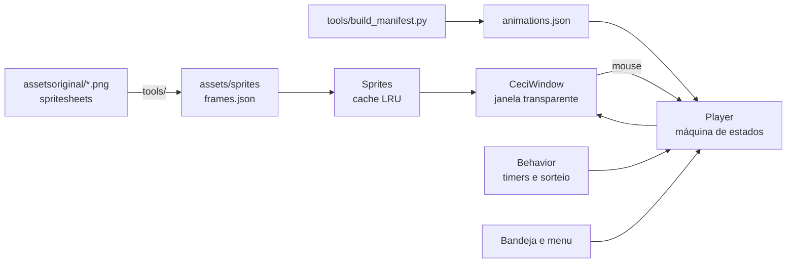

<p align="center">
  
</p>

<h1 align="center">Ceci Bot</h1>

<p align="center">
  Uma mascote chibi animada que mora na área de trabalho do Windows.<br>
  <b>sem IA</b> · <b>leve</b> (≈0,5% de CPU e ~70 MB de RAM, medidos) · <b>avisa os prazos da Sala Virtual</b>
</p>

<p align="center">
  
  
  
  
</p>

<p align="center">
  
</p>

---

## ✨ O que ela faz

- **Vive na tela**: janela transparente e sem borda. Os cliques passam pelas áreas vazias, e ela fica sempre por cima das outras janelas (opcional).
- **Fala com você**: um balão em cima da cabeça escreve letra a letra, como nos RPGs antigos. São 274 frases fixas em 41 situações: cliques, carinho, arraste, girar ela no ar, café, leitura, sono, o gato e outras. As falas saem em sequência, nunca uma cortando a outra. Não usa IA.
- **Tem rotina própria**: respira, pisca, ajeita os óculos, lê, toma café, brinca com o gato, cochila e passeia pela tela. Tudo isso por timers e sorteio, sem IA.
- **Reage a você**:
  - **Mouse**: os olhos seguem o cursor quando você mexe rápido.
  - **Clique**: clicar nela (cabeça ou corpo) é o mesmo que "Interagir": ela acena, fica feliz, manda beijinho ou coração.
  - **Carinho**: passe o mouse para lá e para cá sobre a cabeça dela algumas vezes, sem clicar.
- **Senta nas janelas e na página**: sobe nas janelas abertas e também nos botões, imagens e campos da página do navegador (lidos pelo UI Automation do Windows, só leitura: ela nunca clica nem digita). Acompanha quando a janela anda ou a página rola, e cai quando o lugar some.
- **Mesma personalidade em todos os PCs**: com OneDrive, a personalidade e o humor dela ficam numa pasta sincronizada. A conversa é de cada PC.
- **Senta na barra de tarefas**: quando senta na beirada, fica apoiada no topo da barra com as pernas balançando por cima dela, em vez de flutuar.
- **Pode ser arrastada**: ela fica pendurada enquanto você segura. Solta no ar, ela cai, sente o impacto e se levanta. Levada até a borda de baixo, pousa na hora.
- **Transições suaves**: dissolve entre os quadros e entre as animações, sem teleportes. As atividades repetem só o "miolo" (ex.: folhear o livro) e só guardam as coisas quando ela vai fazer outra coisa.
- **Sai com estilo**: ao fechar, ela anda até o canto mais próximo e sai correndo pela borda da tela. Depois volta só a mão para buscar o livro que caiu.
- **Respeita o seu PC**: pausa em jogos e apps em tela cheia. Ao ser ocultada, todos os timers param. Tem modo econômico. Abre uma vez só: abrir de novo não cria uma segunda Ceci por cima da primeira.

## 🎓 Sala Virtual (Fase 2)

A Ceci cuida dos prazos da [Sala Virtual do IFSULDEMINAS — Muzambinho](https://salavirtual2.muz.ifsuldeminas.edu.br) (Moodle) para nenhuma entrega passar despercebida. Sem IA, sem serviço pago e só leitura: ela nunca envia, responde, tenta questionário nem muda nada na sua conta.

**Conectar**: Configurações → **Conectar Sala Virtual**. Abre a página oficial de login numa janela do Edge; você digita CPF e senha lá. A Ceci não vê nem guarda a senha. Ela guarda só os cookies da sessão, cifrados pelo Windows (DPAPI), e fecha o navegador.

**Uma consulta automática por dia** (padrão 08:00, horário de São Paulo, configurável). Se o PC estiver desligado no horário, a consulta do dia acontece quando o app abrir. Se falhar, ela avisa e não tenta de novo sozinha: use **Conferir agora**, que não gasta a consulta automática. Entre as consultas não roda nada: nenhum navegador, nenhuma checagem de internet.

**O que ela lê**: as suas disciplinas, a Linha do tempo, o Calendário (do mês passado até 6 meses à frente), o conteúdo de cada disciplina e a página de cada tarefa e questionário (status de envio). Cada atividade é identificada pelo id do Moodle, então a mesma atividade vista em várias fontes não duplica.

**Lembretes** (calculados com os dados salvos, sem consultar o Moodle de novo): 7 dias, 3 dias, 24 h e 2 h antes, no dia e quando atrasa. Cada aviso sai uma vez só por atividade e prazo. Prazo mudou? Os lembretes são refeitos. O Moodle confirmou a entrega? Os lembretes param. Há horário silencioso e respeito à tela cheia, com opção para os alertas importantes.

**Como ela avisa**: falando. Sem janela e sem cartão: cada aviso sai no balão, um atrás do outro, com a disciplina, o nome da atividade e o prazo. A notificação do Windows só aparece quando ela não pode falar (pausada, oculta ou com tela cheia), para o aviso não se perder.

| Evento | Animação | Fala |
|---|---|---|
| Conferindo a Sala Virtual | Conferindo Sala Virtual | — |
| Gravando os dados | Atualizando dados | — |
| Atividade nova | Mostrando tarefa | "Opa! Temos atividade nova!" + nome e prazo |
| Prazo chegando (7 e 3 dias) | Mostrando lembrete | "Pssiu! Olha a data dessa entrega!" |
| Prazo urgente (24 h, no dia, 2 h, atraso) | Prazo urgente | "CARALHO, ISSO VENCE HOJE!" (só quando vence hoje mesmo) |
| Vários avisos juntos | Resumo do dia | "Tenho N avisos da faculdade" e fala um por um |
| Consulta concluída | Sucesso | "Prontinho! Sua lista tá atualizada." |
| Falha (sessão, internet, consulta) | Erro / Confusa | a frase do que aconteceu de verdade |

As animações "Sincronização falhou" e "Sem internet" não existem nas spritesheets, então a falha usa **Erro** e a falta de internet usa **Confusa**. Nenhum quadro foi inventado.

**Perguntar para ela**: **clique duplo** nela abre uma caixinha para digitar. Ela não tem IA, então entende palavras fixas e responde falando:

| Você digita | Ela fala |
|---|---|
| atividades, tarefas, pendentes | quantas tem, as próximas (nome, disciplina, prazo) e as atrasadas |
| prazo, próxima | a próxima entrega |
| hoje, amanhã, semana | o que vence nesse período |
| atrasadas | as que passaram do prazo sem entrega confirmada |
| resumo | hoje, semana, atrasadas e novidades da última consulta |
| conferir | consulta a Sala Virtual agora |
| fiz + pedaço do nome | marca a atividade como feita por você ("não fiz" desmarca) |
| ajuda | a lista do que ela entende |

O que ela não entende, ela diz que não entendeu. No menu, **Minhas atividades** e **Resumo da faculdade** fazem ela falar o mesmo, e **Conferir Sala Virtual agora** consulta na hora. Tudo funciona offline com os dados da última consulta; se eles estiverem velhos ou a última consulta falhou, ela avisa.

**Status de cada atividade**: pendente, entrega confirmada pelo Moodle, concluída (critério do Moodle), atrasada, sem prazo definido, status desconhecido ou marcada por você. "fiz" é só uma marca sua: não conta como entrega confirmada. Rascunho salvo também não conta.

**Limites honestos**:
- A Sala Virtual está com os web services do Moodle desligados, então não existe API para aluno. A Ceci lê pelas mesmas chamadas que o Painel do Moodle usa, com a sua sessão.
- A sessão do Moodle expira depois de 8 h sem uso. Se ela expirou na hora da consulta, a Ceci pede para você entrar de novo. Se o calendário exportado do Moodle estiver disponível, ela ainda confere os prazos por ele, mas avisa que o status de envio não foi conferido.
- Com uma consulta por dia, algo publicado depois da consulta só aparece na próxima (ou em **Conferir agora**). Por isso a data da última sincronização fica sempre à vista.

Dados locais: `%APPDATA%\Ceci Bot\sala_virtual.db` (SQLite), `sala_virtual.sessao` (cifrado) e `sala_virtual.log` (sem cookies, chaves nem senhas). **Desconectar e apagar sessão** apaga a sessão e encerra o login no Moodle.

## 🧠 IA da Ceci (Fase 3)

A barrinha do clique duplo passa por um roteador: **comando registrado** (ex.: "mostra minhas atividades", "abre as configurações", "fica quietinha", "vai dormir", "abre a atividade de Pesquisa Operacional", "abre o chat") roda na hora, sem IA. **Pergunta sobre as atividades** ("tenho atividade amanhã?") vai para a IA junto com só o recorte certo do banco da Sala Virtual, depois de você autorizar uma vez. **O resto** é conversa com a personalidade de `assets/ceci_personality.txt`. A animação muda de acordo com a resposta. O histórico completo fica em botão direito → **Abrir chat**.

**Situação do provedor**: o Gemini Web **não está conectado**. O `robots.txt` do gemini.google.com fecha as páginas do chat para automação e os Termos do Google tratam esse acesso como abuso, então a Ceci não automatiza a página. O núcleo funciona com qualquer provedor que implemente `AIProvider` (`ceci/ia/provider.py`). Sem provedor, os comandos continuam, perguntas sobre atividades são respondidas com os dados locais e a conversa avisa que não há IA conectada.

**Ctrl+Alt+C**: a Ceci olha a sua tela (print só na hora, só pra IA que enxerga imagem) e comenta ou responde o que você perguntar sobre ela. Pedir na conversa ("olha isso aqui", "tá vendo esse erro?") também tira um print na hora; prints antigos ficam marcados como velhos, então ela não mistura a tela de agora com a de antes. Arraste um **.txt/.md** em cima dela pra ela ler.

**Espiar a tela sozinha** (ligada; desliga no menu): quando você para 5 s numa janela ou aba nova (navegador ou qualquer programa do PC), ela espia e solta um comentário curto. No máximo uma vez a cada 3 minutos, e nunca em aba anônima, de login/senha, banco, e-mail, conversa (WhatsApp, Telegram, Discord...) ou gerenciador de senha. Ela só lê o título da janela da frente; o print fica só na memória.

**Pedir pra ela fazer algo**: "então dorme, linda", "toma um café aí", "sobe na janela", "brinca com o Bowie"... O pedido é comparado com o que ela sabe fazer (dormir, café, ler, gato, acenar, dançar, programar, se espreguiçar, se esconder, sentar, subir/descer da janela, passear) e ela faz de verdade. O que não existe ela diz que não faz.

**Sentar nas janelas** (ligada): ela pula para a borda de cima das janelas abertas, senta com as pernas balançando, vai junto quando você arrasta a janela e cai quando a janela fecha, minimiza, maximiza ou fica coberta. Em cima do vídeo flutuante (colado no topo da tela) ela fica sentada. Soltar ela no ar em cima de uma janela também funciona.

## 🖼️ Galeria

<p align="center">
  
</p>

São **56 animações** feitas a partir de 57 spritesheets desenhadas à mão. A lista completa está no painel **Ver animações** do próprio app.

## 📦 Instalar

### Opção 1: executável (recomendado)

1. Baixe o `CeciBot-windows.zip` na página de [Releases](../../releases/latest).
2. Extraia a pasta onde quiser.
3. Abra o `Ceci Bot.exe`.

As configurações ficam em `%APPDATA%\Ceci Bot\settings.json`. O .exe e a versão de código usam o mesmo arquivo.

### Opção 2: rodar pelo código

```bash
pip install -r requirements.txt
python main.py
```

Use `pythonw main.py` para abrir sem console. O app precisa do `PySide6-Essentials`; a Sala Virtual usa também o `playwright` (só para abrir a janela de login no Edge que já vem no Windows, sem baixar navegador).

### Gerar o executável

```powershell
powershell -ExecutionPolicy Bypass -File tools\build_exe.ps1
```

O script gera `%LOCALAPPDATA%\Programs\Ceci Bot\Ceci Bot.exe` com PyInstaller e cria o atalho na área de trabalho.

## 🖱️ Como interagir

| Ação | O que acontece |
|---|---|
| Mexer o mouse rápido perto dela | Ela acompanha o cursor com o olhar enquanto ele mexer (perto ou longe) e continua olhando 1 a 3 s depois que ele para. Cada direção dura no mínimo 1,5 s, e depois ela espera 10 s para voltar a seguir. |
| Clicar nela (cabeça ou corpo) | Interagir: reage conforme o humor (acena, fica feliz, fofa, apaixonadinha, manda beijinho ou coração, fica confusa) e fala uma frase de clique. Se você não para de clicar, interrompe o que ela tava fazendo ou acabou de acordá-la, pode ficar brava |
| Clique duplo nela | Caixinha para digitar uma pergunta (atividades, prazo, hoje, resumo...) |
| Passar o mouse várias vezes pela cabeça (vai e volta) | Carinho: ela reage conforme o humor (gosta, fica feliz, apaixonadinha ou fofa); carinho demais, na hora errada ou logo depois de acordar, ela fica brava. Dormindo, só acorda |
| Clicar e arrastar | Fica pendurada. Ao soltar, cai e pousa (na borda de cima de uma janela, se tiver uma embaixo). |
| Girar ou sacudir enquanto arrasta | Reclama ("VOU VOMITAR!") e pousa tonta |
| Clique direito | Menu: Interagir, Falar algo, Passear, Ver animações, Mover para outro canto, Alterar tamanho, Olhar minha tela, Minhas atividades, Resumo da faculdade, Conferir Sala Virtual agora, Abrir chat, Pausar animações, Sentar nas janelas, Espiar a tela sozinha, Configurações, Ocultar, Sair |
| Ícone na bandeja | Mostrar, Ocultar, Pausar animações, Sentar nas janelas, Espiar a tela sozinha, Configurações, Sair |

## ⚙️ Configurações

**Valores ajustáveis**: tamanho, velocidade das animações, FPS máximo do movimento, frequência das ações automáticas, frequência das falas e posição inicial (canto direito, canto esquerdo ou última posição). Tudo fica salvo até você mudar de novo.

**Opções liga/desliga**:
- movimentação automática
- olhar acompanhando o mouse
- carinho na cabeça
- animações especiais automáticas
- sempre visível
- iniciar com o Windows
- pausar em tela cheia
- modo econômico
- respiração sutil quando parada
- entrar pela porta ao abrir
- falas no balão

## 🧠 Como funciona



- **`ceci/engine.py`**: o `Player` é uma máquina de estados com prioridades. Cada animação segue três partes: início, miolo e final. O miolo repete por um tempo ou por um número de voltas. Um pedido feito durante o miolo entra na fila e toca o final antes; o arraste interrompe na hora.
- **`ceci/window.py`**: janela transparente, dissolve entre quadros, respiração, caminhada com a velocidade casada à passada, arraste com gravidade e olhar acompanhando o mouse.
- **`ceci/behavior.py`**: a rotina automática. Pesos e cooldowns escolhem o que ela faz, o cochilo fica mais provável depois de muito tempo sem interação, e ela só anda para o lado que tem espaço.
- **`ceci/sprites.py`**: carrega os quadros sob demanda, já escalados para o tamanho e o DPI da tela.
- **`ceci/speech.py`**: o balão de falas e a fila. Cada animação tem sua categoria de frases em `assets/falas.json`, e cada categoria é sorteada sem repetir.

### Pipeline dos sprites

As folhas originais foram desenhadas em fundo magenta e cada uma com proporções, cores e enquadramento um pouco diferentes. Ferramentas em `tools/` deixam tudo consistente:

1. **Recorte** (`extract.py`): tira o fundo magenta sem apagar detalhes vermelhos e rosas, detecta os quadros e alinha pelos pés.
2. **Escala**:
   - `facescale.py` acha o rosto em cada quadro e iguala o tamanho da cabeça.
   - `sizematch.py` garante que nenhuma animação fique maior que o idle.
   - `register.py` alinha uma folha pelo desenho inteiro.
3. **Cor** (`palette.py`): paleta única de pele, mechas, pretos e roupa para todas as folhas.
4. **Estabilidade**:
   - `stabilize.py` mantém a cabeça parada dentro de cada animação.
   - `transitions.py` confere todas as passagens do manifesto.
   - `overlay.py` gera folhas de conferência visual.

Detalhes e ordem de execução: [docs/PIPELINE.md](docs/PIPELINE.md).

## 🧪 Testes

```bash
python tests/engine_test.py   # miolo repete, final toca antes da troca, arraste corta na hora
python tests/drag_test.py     # pouso na borda de baixo e queda até o chão
python tests/quit_test.py     # anda até o canto e sai pela borda (dos dois lados)
python tests/smoke_test.py    # toca todas as animações sem erro nem quadro faltando
python tests/speech_test.py   # balão letra a letra, fila sem cortar fala, tchau antes de sair
python tests/settings_test.py # tamanho escolhido continua ao abrir de novo
python tests/edge_test.py     # anda até a parede antes de esconder; perna sai uma vez só na saída
python tests/spin_test.py     # girar/sacudir no ar tem falas próprias; arrastar reto não
python tests/interact_test.py # clique = Interagir, carinho passando o mouse, sentada na barra, uma Ceci só
python tests/sala_test.py     # Sala Virtual: os 18 cenários obrigatórios com um Moodle falso local
python tests/sala_app_test.py # a Ceci reage à consulta com as animações e falas certas
python tests/live_test.py     # falas e vontades geradas pela IA (provedor falso)
python tests/chain_test.py    # corrente de provedores com servidor falso
python tests/ia_test.py       # IA: roteador, contexto, dados, falhas e animações com um provedor falso
python tests/screen_test.py   # sem print velho, arquivo só quando perguntam dele, espiada no navegador
python tests/actions_test.py  # "então dorme, linda" → ela dorme de verdade (pedido comparado com as ações dela)
python tests/desktop_test.py  # janelas do Windows: bordas livres, DPI (abre janelas de verdade)
python tests/perch_test.py    # sentar nas janelas de verdade: pousa, segue, cai, pula
```

Os testes da Sala Virtual usam um Moodle de mentira em `127.0.0.1` (`tests/fake_moodle.py`) com dados fictícios. Nenhuma conta real é usada.

Os testes rodam sem abrir janela (`QT_QPA_PLATFORM=offscreen`) e usam uma pasta de configurações temporária. `desktop_test` e `perch_test` precisam da tela de verdade: abrem janelas de teste de outro processo (sempre no topo, sem pegar foco) e fecham no fim.

## 📊 Desempenho (medido)

Medição de 60 s com o executável rodando (rotina automática e falas ligadas), num notebook com Windows 11 e 8 núcleos, na bateria:

| CPU | Memória (working set) | Memória privada | Conexões de rede |
|---|---|---|---|
| 0,47% do total | 61 MB | 28 MB | 0 |

O balão só usa timer enquanto escreve ou está na tela. Falando sem parar, ele somou cerca de 0,1 ponto percentual de CPU (0,35% → 0,45%).

Quando a Ceci é ocultada, os timers param. O modo econômico desliga a respiração e reduz as atualizações.

**Com a Fase 2** (medido em 31/10): o .exe parado, sem consulta rodando, ficou em 0,09% de CPU, 68 MB de working set, 33 MB privados, nenhum processo filho e nenhuma conexão. Uma consulta com 46 atividades no Moodle falso local fez 59 requisições em 0,7 s, com 0,38 s de CPU e +2,6 MB de memória, sem processo filho. Na consulta de verdade há uma pausa de 0,15 s entre requisições, para não pesar no servidor. Só o login abre navegador: o Edge e o Playwright somaram 9 processos e cerca de 500 MB por poucos segundos, e nada fica aberto depois.

## 📁 Estrutura

```
main.py              # app: início, menu, bandeja, tela cheia, fechar animado
ceci/                # engine, janela, rotina, sprites, configurações, UI
ceci/sala/           # Sala Virtual: login, leitura do Moodle, SQLite, lembretes, falas
ceci/command.py      # caixinha do clique duplo
ceci/desktop.py      # janelas do Windows, só lendo: a da frente e as bordas livres para sentar
ceci/watch.py        # espiar o navegador quando você troca de aba
ceci/ia/             # IA: roteador, personalidade, contexto, dados da Sala Virtual, provedor, chat
assets/              # sprites recortados, frames.json, animations.json, falas.json, ícone
assetsoriginal/      # spritesheets originais (fundo magenta)
tools/               # pipeline de sprites, manifesto e build do .exe
tests/               # testes automatizados
docs/                # imagens do README e documentação
PROJECT_STATE.md     # o que está feito, testado e pendente
```

## 🗺️ Estado do projeto

**Fase 1**: a mascote animada e interativa. **Fase 2**: os prazos da Sala Virtual. Ela não usa IA, não lê seus arquivos e não executa comandos; a única conexão é com a Sala Virtual, e só se você conectar. O que está feito, o que foi testado e o que ainda falta verificar estão em [PROJECT_STATE.md](PROJECT_STATE.md).

## 📄 Licença

Ainda não há uma licença definida. Código, personagem e arte são de **todos os direitos reservados** ao autor.
